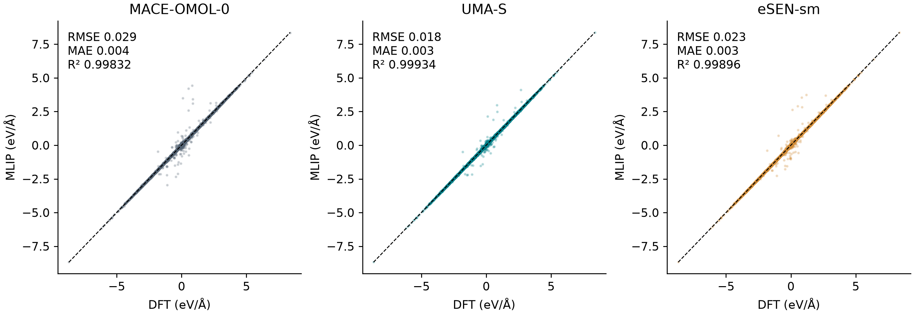
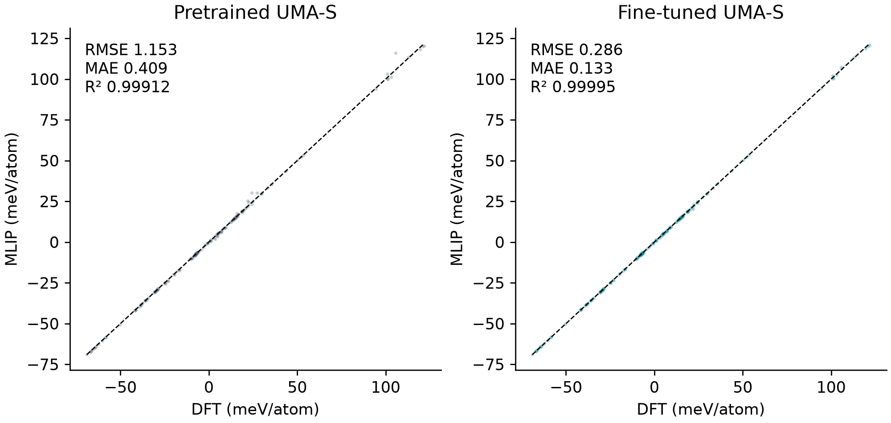
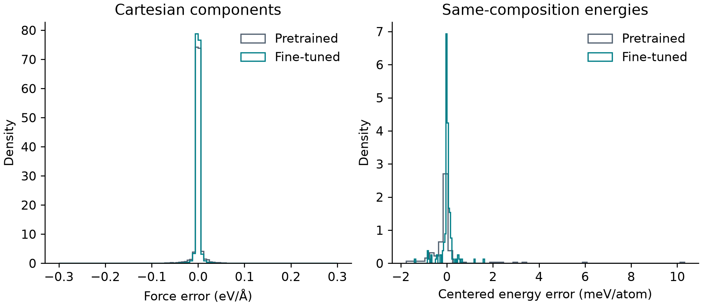
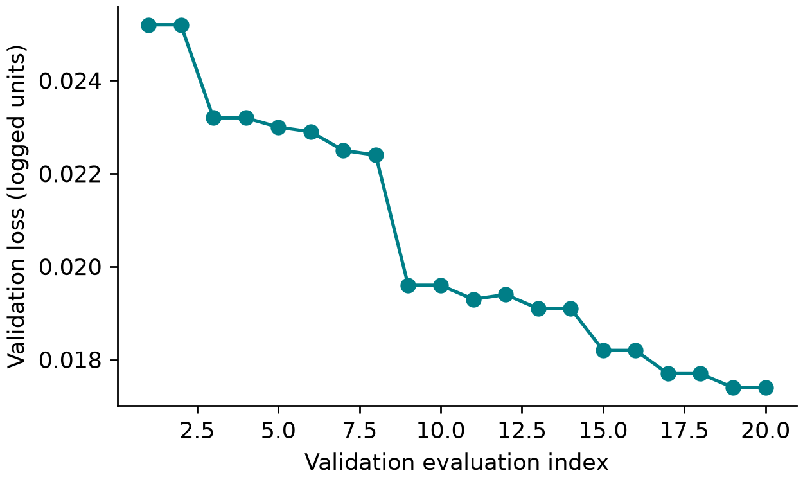

# MLIPs for ZDDP chemistry: benchmark, select, fine-tune

Machine-learned interatomic potentials can enable molecular simulations at a scale beyond routine electronic-structure calculations. But a general-purpose potential can fail on stretched bonds and unusual electronic states relevant to lubricant additives. This project benchmarks MACE, UMA and eSEN against consistent DFT references, selects a foundation model, and adapts it to targeted ZDDP chemistry.

*Zero-shot comparison. Force parity includes all Cartesian components of all atoms in the scored benchmark structures. These data informed model selection; they are not an independent test of a fine-tuned model.*

*Pretrained and fine-tuned UMA-S evaluated on identical held-out configurations. Metrics pool all Cartesian force components; structures contribute in proportion to their number of atoms.*

## Model selection

The benchmark used ORCA ωB97M-V/def2-TZVPD labels following OMol25 settings. It assessed forces, relative energies, conformers, binding curves and reaction energies. UMA-S 1.2.1 and eSEN-sm conserving met all five defined targets; MACE-OMOL-0 met four. UMA-S was selected for fine-tuning based on the broader benchmark, including stretched-bond behavior and practical simulation performance. This is a task-specific selection, not a general ranking of the model families.

## Targeted adaptation

Targeted bond-stretch and finite-temperature configurations were added to the reference set. Related scan-point structures were grouped before splitting: 404 training, 90 validation and 157 test structures in the round-0 refit. The test contains unseen groups, **not unseen bond types**. UMA-S was fully fine-tuned from the pretrained OMol head with replay from OMol25, intended to reduce loss of general chemical knowledge. The refit used a learning rate of 10⁻⁴, batch size 4 and 10 epochs.

*Per-atom energies are centered separately for each chemical composition and model on the test set. This evaluates relative variation within composition, not absolute energies; singleton compositions are excluded. See [evaluation](docs/evaluation.md).*

*Errors on the same test configurations. Force histogram is restricted to ±0.3 eV/Å for readability; tails exist outside the displayed range.*

## What the results mean—and what they do not

The held-out force comparison measures how well the model reproduces local DFT forces on this distribution; it does not establish reaction kinetics or transferability to all ZDDP chemistries. Several stretched C–O configurations remain challenging after fine-tuning, and independent general-domain checks show energy drift, especially for radicals, despite replay. The DFT reference itself can have limitations for condensed-phase properties. Related geometries within a chemistry family and compositional centering further constrain generalization claims.

## Reproduce and audit

See [DFT dataset and calculation workflow](data/dft_round0/README.md), [methodology](docs/methodology.md), [evaluation](docs/evaluation.md), and [reproducibility](docs/reproducibility.md). Reference energies, forces, splits and held-out model predictions are included. Run `python scripts/plot_results.py --out reproduced_figures` to recreate the figures.

*Validation loss as recorded during training; the horizontal axis counts validation evaluations, which occur more than once per epoch. Normalized logged loss is not a physical error metric. A comparable training-loss series has not yet been verified.*
